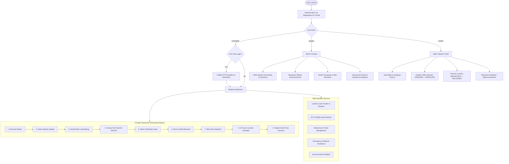
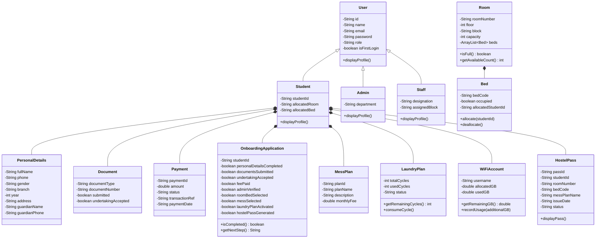

# Product Requirements Document (PRD)

## Project: NIVAS — Hostel Onboarding & Resident Services Platform
- **Document Version**: 1.0.0
- **Document Owner**: NIVAS Product & Engineering Team
- **Project Type**: Academic Java OOP Mini-Project (B.Tech CSE Level)
- **Status**: Production Reference Specification

---

## 1. Executive Summary & Product Vision

### 1.1 Problem Statement
University campus hostels frequently struggle with fragmented, manual onboarding and resident support systems. Key pain points include:
- Physical document verification bottlenecks and manual queues during move-in week.
- Double-booking or misallocation of hostel rooms and specific beds.
- Lack of centralized tracking for annual hostel fee payments and payment references.
- Manual paper logs for student laundry cycle allocations, often resulting in quota disputes.
- Delayed responses to student maintenance tickets and medical emergencies.
- Fragmented broadcast mechanisms for campus hostel notices.

### 1.2 Product Vision
**NIVAS** (*Sanskrit/Hindi for "Abode / Residence"*) is a unified digital platform designed to streamline the entire student residential lifecycle—starting from identity authentication and administrative verification, progressing through fee payments and room/bed allocation, and culminating in daily resident services (laundry, Wi-Fi, tickets, and emergency care).

---

## 2. User Roles & Permission Matrix

NIVAS enforces strict Role-Based Access Control (RBAC) across three distinct user categories:

| Feature / Action | Student | Hostel Staff / Warden | Administrator (Chief Warden) |
| :--- | :---: | :---: | :---: |
| Authenticate with ID & OTP | ✅ | ✅ | ✅ |
| Submit Personal & Guardian Details | ✅ | ❌ | ❌ |
| Upload Mock Aadhaar & Accept Undertaking | ✅ | ❌ | ❌ |
| Process Annual Fee Payment (₹85,000) | ✅ | ❌ | ❌ |
| Verify Student Documents & Payments | ❌ | ❌ | ✅ |
| Browse Rooms & Allocate Bed | ✅ (Self) | ❌ | ✅ (All) |
| Select Mess Plan | ✅ (Self) | ❌ | ❌ |
| Request Laundry Pickup | ✅ (Self) | ❌ | ❌ |
| Update Laundry Pickup Status & Deliver | ❌ | ✅ | ✅ |
| Monitor Personal Wi-Fi Quota (300 GB) | ✅ (Self) | ❌ | ❌ |
| Raise Maintenance Ticket | ✅ (Self) | ❌ | ❌ |
| Assign & Resolve Maintenance Ticket | ❌ | ✅ | ✅ |
| Request Emergency / Medical Assistance | ✅ (Self) | ❌ | ❌ |
| Acknowledge & Act on Assistance Requests | ❌ | ✅ | ✅ |
| Publish Official Announcements | ❌ | ❌ | ✅ |
| Generate & View Digital Hostel Pass | ✅ (Post-Verification) | ✅ (View) | ✅ (View) |

---

## 3. System Architecture & Workflows

---

## 4. Functional Requirements

### 4.1 Module 1: Authentication & Session Management
- **FR-1.1**: The system must authenticate users using credentials (Student ID / Registration ID or Email + Password).
- **FR-1.2**: For student first-time logins, the system must trigger a simulated 6-digit One-Time Password (OTP) dispatch to the console.
- **FR-1.3**: The user must enter the exact 6-digit OTP to complete authentication and establish an active session (`AuthSession`).
- **FR-1.4**: Session state must record User ID, active token, login timestamp, and maintain an expiration threshold of 10 days.

### 4.2 Module 2: The 9-Stage Onboarding Pipeline
The platform enforces a strict sequential state-machine progression (`OnboardingApplication.java`). No stage may be skipped.

1. **Stage 1 — Personal & Guardian Details**:
   - Collects: Full Name, Phone Number (10 digits), Gender, Academic Branch, Year of Study, Permanent Home Address, Guardian Name, and Guardian Phone.
2. **Stage 2 — Document Submission**:
   - Collects mock 12-digit Aadhaar identification string.
   - Marks document submission flag as completed.
3. **Stage 3 — Hostel Rules Undertaking**:
   - Displays university hostel code of conduct, anti-ragging policies, and quiet hours.
   - Student must affirmatively accept the undertaking.
4. **Stage 4 — Annual Hostel Fee Payment**:
   - Fee structure is fixed at ₹85,000 per academic year.
   - Generates simulated Razorpay transaction reference (`RZP_TEST_xxxxxx`), unique Payment ID (`PAY-xxxx`), and timestamps.
   - Updates payment status to `PAID`.
5. **Stage 5 — Administrative Verification Gate**:
   - Mandatory prerequisite: The student cannot proceed to room selection until an Admin logs in and explicitly marks the application as verified (`adminVerifyStudent`).
6. **Stage 6 — Room & Bed Allocation**:
   - System displays room availability matrix (Room Number, Floor, Block, Capacity, and Vacancies).
   - Strict Bed Allocation Rule: Each bed within a room is identified by code (e.g., `Bed A`, `Bed B`). A bed cannot be double-allocated.
   - If an existing student changes room/bed, their previous bed is automatically deallocated.
7. **Stage 7 — Mess Plan Selection**:
   - Offers pre-configured meal plans:
     - `MP01`: Standard Mess Plan (₹4,500/mo) — 4-meal North & South Indian buffet.
     - `MP02`: Premium Mess Plan (₹6,000/mo) — Multi-cuisine buffet with live counter.
     - `MP03`: Pure Vegetarian Plan (₹4,200/mo) — Pure veg and Jain-friendly options.
8. **Stage 8 — Laundry Plan Activation**:
   - Automatically initializes an annual quota of 30 laundry wash cycles.
9. **Stage 9 — Digital Hostel Pass Generation**:
   - Condition: All 8 previous stages must be 100% complete.
   - Outputs: Unique Pass ID (`HP-<StudentID>-<Random>`), student metadata, room and bed numbers, mess plan, issue date, verification checksum (`passId.hashCode()`), and ASCII visual QR code block.

### 4.3 Module 3: Resident Support Services

#### 4.3.1 Laundry Service (`LaundryService.java`)
- **FR-3.1**: Students can place on-demand pickup requests specifying the number of clothes.
- **FR-3.2**: Request state lifecycle: `REQUESTED` → `PICKED_UP` → `PROCESSING` → `READY` → `DELIVERED`.
- **FR-3.3**: Cycle Decrement Rule: When a staff member updates status to `DELIVERED`, the system automatically deducts 1 cycle from the student's remaining quota.
- **FR-3.4**: When remaining cycles reach 0, further pickup requests are rejected.

#### 4.3.2 Wi-Fi Quota Tracker (`WiFiService.java`)
- **FR-3.5**: Each onboarded student is allocated 300.0 GB monthly high-speed campus Wi-Fi data.
- **FR-3.6**: System tracks consumed data (`usedGB`) and dynamically computes remaining data balance.
- **FR-3.7**: Provides simulation utility to record data usage increments with threshold warnings.

#### 4.3.3 Maintenance Ticketing (`TicketService.java`)
- **FR-3.8**: Students can submit non-emergency maintenance issues specifying Category (`Electrical`, `Plumbing`, `Carpentry`, `Network`, `Appliance`) and description.
- **FR-3.9**: Lifecycle states: `SUBMITTED` → `ASSIGNED` → `IN_PROGRESS` → `RESOLVED` → `CLOSED`.
- **FR-3.10**: Staff members can be assigned to tickets and provide resolution notes upon completion.

#### 4.3.4 Emergency & Resident Assistance (`AssistanceService.java`)
- **FR-3.11**: Priority assistance interface for urgent situations with pre-defined categories:
  - `MEDICAL_HELP`: Campus doctor / nurse visit.
  - `AMBULANCE`: Urgent emergency hospital dispatch.
  - `FOOD_IN_ROOM`: Meal delivery for sick or bedridden residents.
  - `URGENT_HELP`: Immediate security or warden intervention.
  - `GENERAL_HELP`: Resident support inquiries.
- **FR-3.12**: Lifecycle states: `REQUESTED` → `ACKNOWLEDGED` → `ASSIGNED` → `IN_PROGRESS` → `COMPLETED` / `CANCELLED`.

#### 4.3.5 Administrative Announcements (`AnnouncementService.java`)
- **FR-3.13**: Admins can publish broadcast bulletins with title, message body, date, and author attribution.
- **FR-3.14**: Bulletins are permanently viewable across all Student and Staff portals.

---

## 5. Non-Functional Requirements (NFRs)

### 5.1 Concurrency & Data Integrity
- **Single Occupancy Invariant**: Under no circumstance may two students be assigned to the same Bed instance within a Room simultaneously.
- **Sequential Guarding**: Digital hostel passes cannot be created without verified payment and admin approval.

### 5.2 Usability & Interface Design
- Clear ANSI/ASCII formatted console layouts with demarcated headers, tables, and demo credentials.
- Descriptive error prompts for invalid input parsing (numbers vs letters) with zero unhandled exceptions.

### 5.3 Modularity & Extensibility
- Clean layer separation: `model/` (pure POJOs and entity logic) vs `service/` (state machines, workflows, validation) vs `Main.java` (CLI presentation).
- In-memory `DataStore` implements the Singleton pattern, allowing future drop-in replacement with SQL/JDBC repositories without refactoring business rules.

---

## 6. Data Model & Schema Overview

---

## 7. Verification & Acceptance Criteria

Every feature of NIVAS is validated against automated tests in [`TestRunner.java`](file:///c:/projects/NIVAS/NIVAS/src/TestRunner.java):

| Phase | Test Description | Verification Condition |
| :---: | :--- | :--- |
| **Phase 2** | Student Authentication | Valid credentials return an authenticated `Student` instance. |
| **Phase 2** | OTP Dispatch & Verification | Generated 6-digit OTP strictly matches entered OTP. |
| **Phase 3** | Details, Aadhaar & Payment | Payment status transitions to `PAID`, transaction ref recorded. |
| **Phase 3** | Administrative Verification | Admin verifies onboarding; flag transitions to `true`. |
| **Phase 4** | Room Allocation & Invariants | Bed allocates successfully to student 1; same bed allocation rejected for student 2. |
| **Phase 5** | Mess Plan Selection | Student instance contains selected `MessPlan`. |
| **Phase 5** | Laundry Quota & Deductions | Initial 30 cycles; upon status transition to `DELIVERED`, cycles decrement to 29. |
| **Phase 5** | Wi-Fi Quota Usage | Recorded usage increases `usedGB` and decrements remaining balance accurately. |
| **Phase 6** | Maintenance Ticketing | Status transitions: `SUBMITTED` → `ASSIGNED` → `RESOLVED`. |
| **Phase 6** | Assistance Requests | Status transitions: `REQUESTED` → `IN_PROGRESS` → `COMPLETED`. |
| **Phase 7** | Announcements | New announcement successfully added to system bulletin. |
| **Phase 8** | Digital Hostel Pass | Pass generated with checksum; onboarding status marked `Completed`. |

---

## 8. Technology Stack & Planned Evolution

### 8.1 Current Implementation (Phase 1 — Academic OOP Reference)
- **Language**: Java 21 / Java 25 (LTS)
- **Architecture**: Modular OOP (Encapsulation, Inheritance, Polymorphism, Composition, Singleton)
- **Build System**: Maven (`pom.xml`) + Standalone `javac` compile runner
- **Storage**: In-memory thread-safe `ArrayList` structures in [`DataStore.java`](file:///c:/projects/NIVAS/NIVAS/src/service/DataStore.java)

### 8.2 Phase 2 Evolution Roadmap
1. **Persistence Integration**:
   - Replace in-memory storage with SQLite / PostgreSQL using JDBC / Hibernate.
   - Utilize the pre-created [`database/`](file:///c:/projects/NIVAS/NIVAS/database) directory for schema migrations.
2. **REST API & Backend Service**:
   - Wrap `src/service/` classes with Spring Boot / Javalin REST controllers.
3. **Web User Interface**:
   - Implement responsive web portal (React / Next.js) matching student move-in UX standards.
4. **Third-Party Integrations**:
   - Real Razorpay Payment Gateway Webhook integration.
   - Twilio / SMS Gateway for actual phone OTP delivery.
